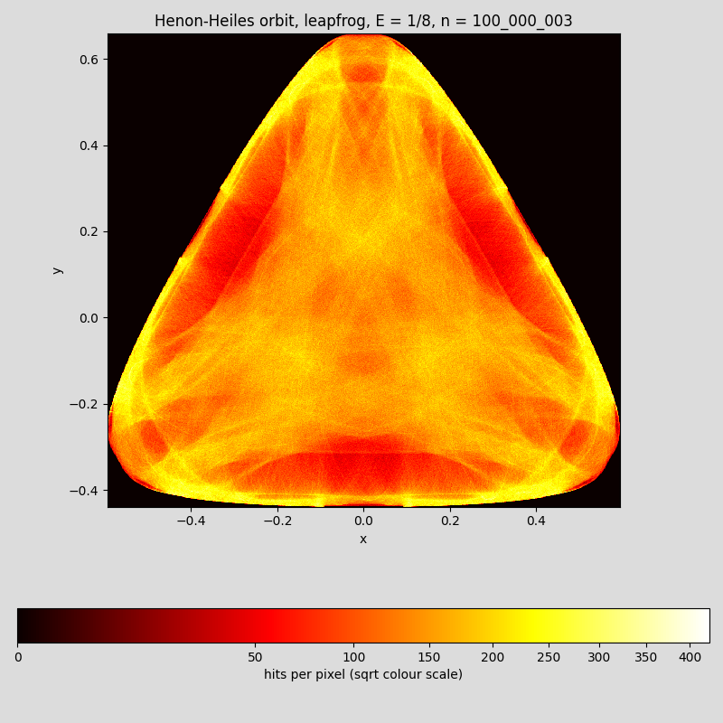
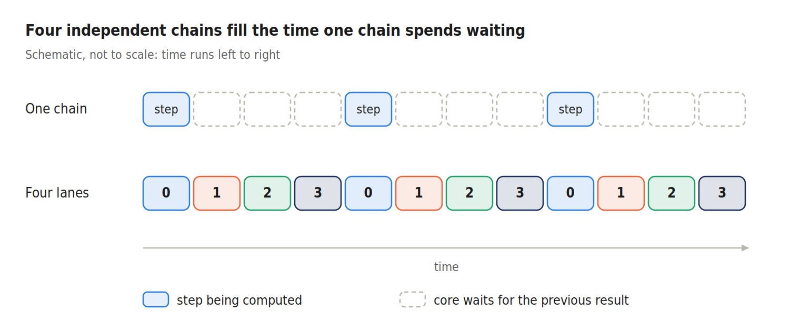
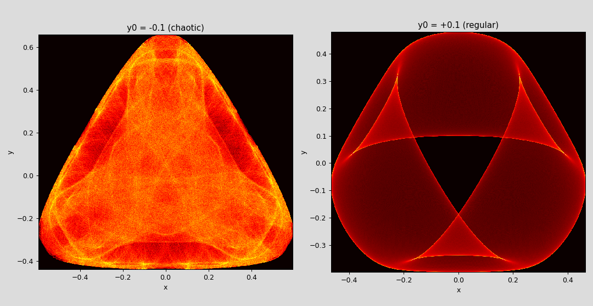

# Hénon–Heiles orbit with leapfrog – the two-pass checkpoint method



A small example that draws where one particle spends its time in the Hénon–Heiles potential. It follows the particle for 100 million leapfrog steps and uses all CPU cores. The trick is the one from the Hopalong project (`hopalong_fast.py`): walk the orbit once to plant checkpoints, then let many workers replay the pieces in parallel. As in Hopalong, every worker advances 4 pieces side by side ("lanes").

It answers a question from a reader of the Hopalong article: *can this be used with a Verlet / leapfrog loop?* For a small system like this one, yes.

- **Exact:** the picture is identical to a plain single-core loop with the same step, pixel for pixel.
- **Small:** the orbit is never stored. A checkpoint is just four numbers.
- **Fast where it counts:** 4 lanes in the parallel pass, and a leapfrog step with a short chain of calculations (merged kicks and fused multiply-add). See [What speed-up to expect](#what-speed-up-to-expect).
- **Short:** one file, about 160 lines of Python.

## Contents

- [Hénon–Heiles orbit with leapfrog – the two-pass checkpoint method](#hénonheiles-orbit-with-leapfrog--the-two-pass-checkpoint-method)
  - [Contents](#contents)
  - [Quick start](#quick-start)
  - [The system](#the-system)
    - [Time stepping: leapfrog](#time-stepping-leapfrog)
  - [How the method works](#how-the-method-works)
    - [The two passes](#the-two-passes)
    - [Lanes](#lanes)
    - [How a point becomes a pixel](#how-a-point-becomes-a-pixel)
    - [Why the result is exactly the same](#why-the-result-is-exactly-the-same)
    - [What is special about leapfrog](#what-is-special-about-leapfrog)
  - [What speed-up to expect](#what-speed-up-to-expect)
  - [Reading the picture](#reading-the-picture)
  - [Chaotic or regular?](#chaotic-or-regular)
  - [When does this make sense?](#when-does-this-make-sense)
  - [Code map](#code-map)
  - [Configuration](#configuration)
  - [Verification](#verification)
  - [Limitations and notes](#limitations-and-notes)

---

## Quick start

**Requirements:** Python 3, `numpy`, `numba`, `matplotlib` (`llvmlite` comes with numba).

```bash
pip install numpy numba matplotlib
python henon_heiles_minimal.py
```

The script asks nothing. It computes the picture twice: once with a plain serial loop (no segments, no lanes) and once with the parallel method. It compares the two, prints the times, and opens a window with the picture. Output on an Apple Mac mini M2 (8 threads):

```text
plain serial loop (no segments, no lanes):       total 0.95 s
16 tasks x 4 lanes, 8 threads: pass 1 0.46 s, pass 2 0.07 s, total 0.53 s
identical to the serial loop (every pixel and every extent): True
```

The first start takes a few seconds because numba compiles the code (the script does not cache it). The window stays open until you close it.

---

## The system

A particle moves in the plane under a force from this potential, a standard model for a star moving in the field of a galaxy:

$$
V(x, y) = \frac{1}{2}\,(x^2 + y^2) + x^2 y - \frac{1}{3}\,y^3
$$

The force points downhill:

$$
F_x = -x - 2xy, \qquad F_y = -y - x^2 + y^2
$$

The total energy (motion plus position, mass 1) stays constant. Here it is set to E = 1/8:

$$
E = \frac{1}{2}\,(p_x^2 + p_y^2) + V(x, y)
$$

Near the origin the potential is a bowl. Farther out it has three saddle points, like mountain passes. Above E = 1/6 the particle could escape through them. At E = 1/8 it can't, so it stays inside a closed, rounded triangle forever.

### Time stepping: leapfrog

With q = (x, y) and p = (px, py), one step of length h is a kick followed by a drift:

$$
p \leftarrow p + h\,F(q), \qquad q \leftarrow q + h\,p
$$

First the force kicks the momentum, then the position moves with the new momentum. In this form the momentum always sits half a step behind the position: the two "leap over" each other, hence the name. It is the same scheme as velocity Verlet with two half kicks per step. The two half kicks of neighbouring steps are simply merged into one full kick. That saves work and, more importantly, shortens the chain of calculations that each step has to wait for.

Two consequences of the half-step offset:

- The loop must start with the momentum half a step back:

$$
p_{-1/2} = p_0 - \frac{h}{2}\,F(q_0)
$$

- To read the energy at the same moment as the position, move the momentum forward again:

$$
p_{\mathrm{sync}} = p + \frac{h}{2}\,F(q)
$$

```python
@njit(inline='always')
def step(x, y, px, py, fx, fy, h):
    px = fma(h, fx, px)           # kick
    py = fma(h, fy, py)
    x = fma(h, px, x)             # drift
    y = fma(h, py, y)
    fx, fy = force(x, y)
    return x, y, px, py, fx, fy
```

`fma(a, b, c)` computes `a * b + c` with a single rounding. It is faster than a multiplication followed by an addition, and because it is exactly rounded by definition, it gives the same bits on every machine. (This is not numba's `fastmath`, which stays off.) The force uses it too:

```python
@njit(inline='always')
def force(x, y):
    return -fma(2.0 * y, x, x), fma(y, y, fma(-x, x, -y))      # = (-x - 2xy,  -y - x^2 + y^2)
```

Leapfrog keeps the energy from drifting away: it only wobbles a little around the right value. Over all 100 million steps the energy stays within 3.2·10⁻⁶ of 0.125 for the default start and within 3.6·10⁻⁶ for `Y0 = 0.1` (about 0.003 %).

---

## How the method works

### The two passes

Every step needs the result of the step before it, so you can't hand different parts of the orbit to different cores. The trick is to walk the orbit twice:

```text
 PASS 1   one worker walks the whole orbit once (serial)
   |        remembers the smallest and largest x and y  -> how big is the picture?
   |        saves (x, y, px, py) at the start of every segment  -> the checkpoints
   v
 PASS 2   many workers at the same time (parallel)
          worker 1: replays 4 segments side by side (4 lanes) -> own pixel grid 1 --+
          worker 2: replays 4 segments side by side (4 lanes) -> own pixel grid 2 --+--> add up --> picture
          ...
```

The orbit is cut into consecutive **segments**: 2 tasks per thread, 4 segments per task, so 8 segments per thread (64 on an 8-thread machine). A **checkpoint** is the exact state at the start of a segment. If the number of points doesn't divide evenly, the leftover points go to the last segment, so every point is counted exactly once.

### Lanes

A single chain of steps spends most of its time waiting: each step needs the result of the one before it, so the core is mostly idle between the dependent calculations. In pass 2 every task replays four segments in lock-step. The four chains don't depend on each other, so while one waits, the core works on another.



Pass 1 can't use lanes, because it is one orbit and therefore one chain. That is why the step itself is built to have a short chain (see above).

### How a point becomes a pixel

The grid covers exactly the smallest and largest x and y of the orbit, so you must know them before you can count. That is why pass 1 comes first. With `W` columns, a point goes into column

$$
\mathrm{column} = \left\lfloor \frac{(x - x_{\min})\,W}{x_{\max} - x_{\min}} \right\rfloor
$$

Rows work the same way with y. A point exactly on the right or top edge goes into the last pixel.

### Why the result is exactly the same

A worker that starts at a checkpoint repeats exactly the same arithmetic as the single walker did, so it makes exactly the same points. Only the order of the tally marks differs, and adding whole numbers does not depend on the order. So the picture does not depend on the number of cores either.

This matters because the motion is chaotic: even a tiny difference in the last digit would grow until the replayed orbit looked completely different. So both passes use the very same `step` function, and the only operations in it are exactly rounded ones (add, multiply, fused multiply-add). Do **not** switch on numba's `fastmath`.

### What is special about leapfrog

The checkpoint must hold the complete state: position and momentum, four numbers here. The momentum is stored exactly as the loop holds it, half a step behind. The force is not stored. It is computed from `(x, y)` by the same code, so it comes out with the same bits as in pass 1.

---

## What speed-up to expect

Pass 1 is serial. Pass 2 shrinks with the number of cores:

$$
\text{total time} \approx t_1 + \frac{t_2}{\text{number of cores}}
$$

where `t1` is the time of pass 1 and `t2` the time of pass 2 on one core. Measured on an Apple Mac mini M2, 100,000,003 points, 1000 × 1000 pixels:

| | Pass 1 | Pass 2 | Total |
| --- | --- | --- | --- |
| plain serial loop (no segments, no lanes) | – | – | 0.95 s |
| 16 tasks × 4 lanes, 8 threads | 0.46 s | 0.07 s | 0.53 s |

Pass 1 can't be skipped, so the total never gets below `t1`. Cores and lanes make pass 2 small, and then pass 1 is what is left. The way to shrink it is a shorter chain of calculations inside the step. That is why the step uses merged kicks and fused multiply-add. Compared with the first version of this example (`henon_heiles_minimal_v1.py`), both passes got faster.

---

## Reading the picture


The particle was followed for 10⁸ steps of length 0.01, that is 10⁶ time units. Each step adds one tally to the pixel where the particle is.

1. **The axes are positions.** Only x and y are shown. The velocities are not.
2. **The colour is time spent.** Every step has the same length, so hits per pixel are proportional to the time the particle spent there. The colour scale is a square root, so the sparse regions are lifted. The numbers on the colour bar are real counts. Compare regions with each other; the absolute numbers depend on the number of points and the pixel size.
3. **Black means never visited.** The triangle with rounded corners is the curve where the potential equals the energy. The particle can't go beyond it. The corners point toward the three saddle points.
4. **The bright rim.** Near the edge the particle runs out of energy for going further, slows down, and turns around, so it lingers there. Like a ball rolling up the side of a bowl.
5. **The bright thin curves inside.** These are places where many paths bunch up or turn around together (they are called caustics).
6. **The dark patches.** The orbit visits these spots less often. Don't read them as the regular "islands" known from other plots: the picture is a flat shadow of a four-number state.
7. **The speckle.** That is noise from the finite number of points. More points make it smoother.

---

## Chaotic or regular?

The picture belongs to **one orbit from one start point**, not to the potential alone. The start is `x = 0`, `y = Y0`, `py = 0`, and `px` follows from the energy.



Left: the default start `Y0 = -0.1` (here with 2·10⁷ points, so grainier than the main picture). Right: `Y0 = +0.1`, same potential, same energy. The picture is completely different: smooth, noise-free, with sharp edges and a clean empty triangle in the middle.

The difference is real. Two orbits started 10⁻⁹ apart end up about 0.33 apart after 2000 time units for `Y0 = -0.1`, but only 3·10⁻⁷ apart for `Y0 = +0.1`. The first orbit is chaotic: it wanders through the whole allowed region and fills it with grain. The second is regular: it stays on a fixed track and traces out smooth shapes. As a rough rule, speckle without holes means chaotic, and smooth sharp-edged shapes mean regular.

---

## When does this make sense?

**A good fit:**

- A few numbers describe the whole state (one particle in a 2D potential, a small system of equations), so a checkpoint is tiny.
- You want one specific long trajectory, not an average over many independent runs.
- Each point comes with some work on top of the step (counting, binning, measuring something). The more of it, the more you gain.
- The result must be exactly the same as in a normal run.

**A poor fit:**

- **Many-particle simulations.** There the force calculation is the expensive part of every step, and pass 1 has to repeat the whole serial run. It is better to speed up the force itself (threads, neighbour lists, GPU). The plot range is usually known from the box, so one pass is enough. And the checkpoint is the whole system: six numbers per particle, about 48 MB for a million particles.
- Anything that needs memory of the past (autocorrelation, mean squared displacement). The segments would need to overlap.
- Cases where independent runs are fine. If you only want an average, many runs from different start points are simpler.

**Care needed in the many-numbers case:** if threads add up the forces in a different order each run, the result differs in the last bits, and a chaotic system amplifies that. The replay would then drift away from pass 1. You need a fixed summation order.

---

## Code map

| Function | Role |
| --- | --- |
| `fma(a, b, c)` | Fused multiply-add `a * b + c` with a single rounding (small numba intrinsic). |
| `force(x, y)` | The force from the potential. |
| `step(...)` | One leapfrog step (kick, drift). The same function is used in both passes and in the reference loop. |
| `start_state(...)` | Start point; puts the momentum half a step back. |
| `first_pass` | Pass 1: walks the orbit serially, returns the extents and the checkpoints. |
| `hit(...)` | Puts one point into its pixel. |
| `second_pass` | Pass 2: parallel over tasks (`prange`), 4 lanes per task, one private pixel grid per task. |
| `density(n, tasks)` | Runs both passes, adds the grids, returns image, extents and times. The orbit is cut into `tasks × 4` segments. |
| `serial_reference` | Plain two-pass loop without segments and lanes. Only used for the check and as the speed baseline. |
| `plot(img, ext, n)` | The picture (square-root colour scale, colour bar). |

---

## Configuration

Constants at the top of `henon_heiles_minimal.py`:

| Constant | Default | Meaning |
| --- | --- | --- |
| `LANES` | `4` | Segments advanced side by side per task. The kernel is written out for exactly 4. |
| `DT` | `0.01` | Time step `h`. |
| `SHAPE` | `(1000, 1000)` | Pixel grid (rows, columns). |
| `Y0` | `-0.1` | Start height. Try `0.1` for a regular orbit. |
| `ENERGY` | `0.125` | E = 1/8. |
| `n` in the main block | `100_000_003` | Number of points. Deliberately not divisible by the number of segments. |

Number of threads: set the environment variable `NUMBA_NUM_THREADS`, for example `NUMBA_NUM_THREADS=4 python henon_heiles_minimal.py`.

---

## Verification

- **Plain serial loop vs. the parallel method:** on a one-core Linux machine, the image and the extents were bit-identical for all 18 combinations tested: 3 values of n (1,000,003, 5,000,017 and 20,000,001, none divisible by the segment count) times 1, 2, 3, 7, 16 and 32 tasks (4 to 128 segments).
- **Apple M2, 8 threads, 100,000,003 points, 64 segments:** the `True` line in [Quick start](#quick-start).
- **Energy:** within 3.2·10⁻⁶ of 0.125 over 10⁸ steps for the default start, 3.6·10⁻⁶ for `Y0 = 0.1`.
- **Is the test strict enough?** I put a deliberate error in the last digit into the step (`h * 1.0000000000000002` in the drift) and ran the comparison again. It fails for both start points. For the chaotic start, 5.3 % of the hits land in a different pixel and the extents change. For the regular start only 1,851 of 100 million hits move, which you would never see by eye, but the exact pixel-by-pixel comparison still catches it.

---

## Limitations and notes

- **Start point.** It must lie inside the allowed region (`V(x, y)` not above E), otherwise the square root for `px` gets a negative number. And don't start with `x = 0` and `px = 0`: `Fx` is proportional to `x`, so `x` would stay zero forever and the orbit would never leave the y axis.
- **Pixel counters.** Each task counts in 4-byte numbers, which overflow at about 4.3 billion. Keep `n / tasks` below that. (The Hopalong script splits the work into more tasks automatically; this minimal script does not.)
- **Memory.** One 4-byte pixel grid per task: 16 × 1000 × 1000 × 4 bytes = 64 MB, plus 8 MB for the sum. It does not grow with `n`. The lanes of a task share its grid. (Calculated, not measured.)
- **Fused multiply-add needs hardware support to be fast.** Apple Silicon and practically every x86 chip of the last ten years have it. Without it the script still gives the same result, but slowly.
- **Not identical to the first version.** The orbit is the same in exact arithmetic as in `henon_heiles_minimal_v1.py`, but the rounding differs in the last digits. The picture looks the same overall; the fine speckle is different.
- **Not independent samples.** The points come from one orbit and are strongly related to each other. The picture shows how often *this* orbit visits each pixel.
- **No `fastmath`.** Both passes must compute bit-identical orbits.
- **Time step.** `DT = 0.01` is not tuned. A smaller step needs more steps for the same time span.
