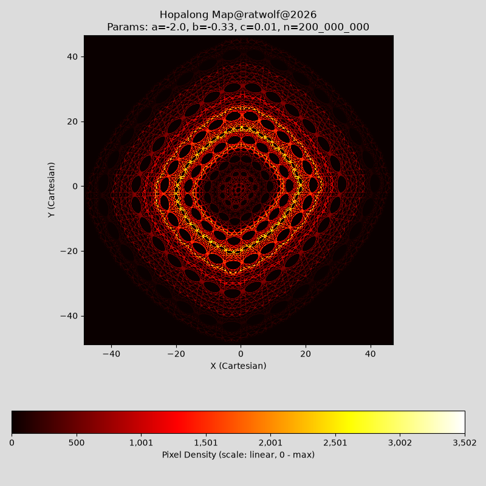

# Hopalong Map – fast, parallel, low-memory – two-pass checkpointed orbit decomposition



Draws the **Hopalong map** (Barry Martin's map) from hundreds of millions or even billions of points, using all CPU cores, **with memory that does not grow with the number of points**.

- **Exact:** the picture is bit-for-bit identical to a plain, single-threaded implementation, and identical for any number of threads (checked with 1 and 8).
- **Fast:** all cores are used, and each core is kept busier than in a naive loop.
- **Small:** memory stays fixed however many points you compute (about 76 MB on an 8-thread machine, on top of Python and its libraries).
- **Two output flavours:** *counts* (hits per pixel) or a proper *probability density* on the colour bar.
- **Three colour scales:** linear, square root, logarithmic.
- Interactive window (matplotlib) plus PNG export.

## Contents

- [Hopalong Map – fast, parallel, low-memory – two-pass checkpointed orbit decomposition](#hopalong-map--fast-parallel-low-memory--two-pass-checkpointed-orbit-decomposition)
  - [Contents](#contents)
  - [Quick start](#quick-start)
  - [The Hopalong map](#the-hopalong-map)
  - [The general approach (checkpoints and segments)](#the-general-approach-checkpoints-and-segments)
    - [The problem](#the-problem)
    - [The idea in one picture](#the-idea-in-one-picture)
    - [Checkpoints (flags) and segments](#checkpoints-flags-and-segments)
    - [Why the result is exactly the same](#why-the-result-is-exactly-the-same)
    - [What is stored, and how much](#what-is-stored-and-how-much)
    - [Lanes: keeping each core busy](#lanes-keeping-each-core-busy)
    - [Where the time goes](#where-the-time-goes)
  - [Counts vs. density](#counts-vs-density)
    - [Counts (default)](#counts-default)
    - [Density](#density)
    - [What the density option is not](#what-the-density-option-is-not)
  - [Colour scales](#colour-scales)
  - [Using it from Python](#using-it-from-python)
  - [Configuration](#configuration)
  - [Code map](#code-map)
  - [Verification and benchmarks](#verification-and-benchmarks)
  - [Limitations and notes](#limitations-and-notes)

---

## Quick start

**Requirements:** Python 3 (developed with 3.15), `numpy`, `numba`, `matplotlib`. Works on macOS and Linux (the memory read-out uses the Unix-only `resource` module; on Windows remove `display_resource_usage`).

```bash
pip install numpy numba matplotlib
python hopalong_fast.py
```

The script asks for six things:

| Prompt | Meaning |
| --- | --- |
| `a`, `b`, `c` | The three parameters of the map (any real numbers; `a = 0` together with `c = 0` is rejected because the orbit would never leave the origin). |
| `n` | Number of points to compute, at least 1000. Scientific notation such as `1e8` is accepted. |
| Colour scale | `linear` (default), `sqrt` or `log` – see [Colour scales](#colour-scales). |
| Colour bar shows | `counts` (default) or `density` – see [Counts vs. density](#counts-vs-density). |

Example session (times and memory will differ on your machine; this one was run on an Apple MacMini M2):

```text
Enter a float value for "a": -3.14
Enter a float value for "b": 0.3
Enter a float value for "c": 0.3
Enter a positive integer value > 1000 for "n": 1e8
Colour scale (linear / sqrt / log) [linear]: sqrt
Colour bar shows (counts / density) [counts]: density
Pass 1 (extents + checkpoints, serial): 0.81 s
Pass 2 (parallel plot):                 0.08 s
Wall-clock time (compute): 0.89 s
Memory (RAM): 221.25 MByte used (peak)
Check: sum(density) * cell area = 1.000000
Image saved to: <OUTPUT_DIR>/py_num=100000000_a=-3.14_b=0.3_c=0.3_sqrt_density.png
```

Then a window opens with the picture, and a PNG is written to `OUTPUT_DIR`. **Change `OUTPUT_DIR` at the top of the script to a folder that exists on your machine.** The PNG is the raw 1000 × 1000 picture without axes; the file name encodes the parameters, the colour scale (`_sqrt`, `_log`) and the mode (`_density`).

The first start takes a few seconds because numba compiles the kernels; they are cached on disk afterwards.

The "Memory" line is the peak of the whole Python process, including Python, numba and matplotlib themselves (roughly 150 MB before anything is computed).

---

## The Hopalong map

Every point is computed from the previous one. Starting at the origin, `(x, y) = (0, 0)`:

$$
x_{k+1} = y_k - \mathrm{sign}(x_k)\,\sqrt{|\,b\,x_k - c\,|}
$$

$$
y_{k+1} = a - x_k
$$

where `sign(x)` is +1 for positive and -1 for negative `x`. The three numbers `a`, `b`, `c` decide what the picture looks like; for example `a = -3.14`, `b = 0.3`, `c = 0.3` gives a ring-and-petal pattern.

Two facts about this map drive the whole design:

1. **It is strictly serial.** Point number 1,000,000 cannot be computed without first computing points 1 to 999,999. You cannot simply hand different parts of the orbit to different CPU cores.
2. **It is deterministic.** The same `(x, y)` always leads to the same next point. There is no randomness. If you know where you are, you know everything that follows.

**A note on "map" versus "attractor".** The Hopalong map is often called an attractor, but it does not pull orbits in from elsewhere. Away from the lines `x = 0` and `b * x = c`, its Jacobian determinant (the factor by which the map stretches areas) is exactly 1, so the map **preserves area**. You can check this by hand: the new `x` changes with `y` at slope 1, and the new `y` changes with `x` at slope -1 and does not depend on `y`, so the determinant is 1. Orbits therefore stay in regions that are determined by where they start, and different start points generally give different pictures. **The picture is the orbit from `(0, 0)`, not a property of `a`, `b` and `c` alone.** That is why the exact orbit is replayed from checkpoints, instead of starting the segments at independent random points.

---

## The general approach (checkpoints and segments)

### The problem

To draw the picture you lay a grid over the plane (here 1000 × 1000 cells) and, for every point of the orbit, add one tally mark to the cell it lands in. Cells that were visited often end up bright. Such a grid of tally counts is called a **histogram**.

Two things make this harder than it sounds:

- **You must know the size of the picture before you can start tallying.** Where is the leftmost point, the topmost? That is only known after the whole orbit has been walked. This is why every implementation needs *two passes*: one to measure, one to draw.
- **Storing the orbit is out of the question.** One point is two decimal numbers, 16 bytes. A billion points would be 16 GB.

A plain implementation therefore walks the orbit twice, one after the other, on a single core.

### The idea in one picture

Think of the orbit as a very long hiking trail where each step depends on the previous one, so one hiker has to walk it in order. The trick:

1. **Pass 1:** one hiker walks the whole trail once. On the way they note the extreme positions (how big must the map be?) and **plant a flag every so often**. A flag records just the exact position at that spot.
2. **Pass 2:** now *many* hikers start at the same time, **each at a different flag**, and each walks only the stretch up to the next flag. Because the trail is deterministic, they all take exactly the steps the single hiker would have taken. Each hiker makes tally marks on **their own private tally sheet**, so nobody gets in anybody's way. At the end, the tally sheets are added up.

```text
 PASS 1  -  one worker walks the whole orbit once (serial)
   |         remembers the smallest and largest x and y   -> how big is the picture?
   |         plants a flag at the start of every segment  -> a few bytes each
   v
 PASS 2  -  many workers, all at the same time (parallel)

   worker 1:  walks segments 0-3    -> marks its own tally sheet 1 --+
   worker 2:  walks segments 4-7    -> marks its own tally sheet 2 --+
   worker 3:  walks segments 8-11   -> marks its own tally sheet 3 --+--> add up all
   ...                                                               |    tally sheets
   worker k:  walks segments ...    -> marks its own tally sheet k --+        |
                                                                              v
                                                                       final picture
```

### Checkpoints (flags) and segments

The orbit is cut into consecutive pieces called **segments**. A **checkpoint** is the exact position `(x, y)` at the start of a segment.

```text
   flag 0        flag 1        flag 2        flag 3        flag 4
     |             |             |             |             |
     v             v             v             v             v
     +-------------+-------------+-------------+-------------+--------- ...
     |  segment 0  |  segment 1  |  segment 2  |  segment 3  |  segment 4
     +-------------+-------------+-------------+-------------+--------- ...
   start (0,0)                                                    the orbit goes on
```

- A worker that starts at flag *k* just keeps computing until it reaches the position stored in flag *k+1*, adding a tally mark for every point on the way.
- If the number of points does not divide evenly into segments, the leftover points are simply added to the last segment, so every point is visited exactly once.

### Why the result is exactly the same

Starting from an exact checkpoint, a worker repeats **exactly the same arithmetic** as the single hiker did, so it produces exactly the same numbers. The set of tally marks is the same as in a single sequential run, only the order in which they are made differs, and adding up whole numbers does not depend on the order. So the picture is identical, no matter how many cores are used.

This matters more than it may seem: the map is chaotic, so even a difference in the 16th decimal place would grow until the replayed orbit looked completely different. Both passes therefore use the very same step function and plain IEEE floating-point arithmetic (do **not** switch on numba's `fastmath`).

### What is stored, and how much

| What | Size | Depends on `n`? |
| --- | --- | --- |
| The orbit itself | not stored at all | – |
| Checkpoints | 16 bytes per segment, about 1 KB in total | no |
| One tally sheet per task | 4 MB each (1000 × 1000 counters of 4 bytes) | no |
| Final picture | 8 MB | no |

With *T* CPU threads the script uses `2 × T` tasks and `4` segments per task, so `8 × T` segments. On an 8-thread machine that is 64 segments, i.e. **1 KB of checkpoints**, instead of 16 GB for a billion stored points. The only memory that grows is the number of tally sheets (one per task), and it grows with the number of cores and with the picture resolution, never with `n`.

The counters of a tally sheet are 4-byte numbers, which overflow at about 4.3 billion. To be safe, no single task is allowed to plot more than 2 billion points (`MAX_POINTS_PER_TASK`); for very large `n` the script simply uses more tasks. The sheets are then added up in 8-byte numbers.

### Lanes: keeping each core busy

Each step needs the result of the previous step, including a square root, which takes the CPU a moment. A core working on one chain of steps spends part of its time waiting. So each task works on **four consecutive segments in lock-step** ("lanes"): while the CPU waits for the square root of lane 1, it already works on lanes 2, 3 and 4. This uses no extra cores, it just makes each core busier. In the benchmark below this makes pass 2 about 3.7 times faster *per core* (0.82 s down to 0.22 s on an Apple M2; the gain depends on the CPU).

### Where the time goes

- Pass 1 is serial: it costs roughly as much as the walk itself.
- Pass 2 is parallel: its time shrinks with the number of cores.

So the total time is roughly `pass 1 + pass 2 / number of cores`. Beyond a handful of cores, pass 1 dominates, and extra cores no longer help much. The script prints both times so you can see this. On an 8-thread Apple M2, pass 1 takes 0.81 s of the 0.87 s total (see the benchmark below).

---

## Counts vs. density

Both options run the **same two passes** and show practically the same picture. They differ in how points are assigned to cells and in what the colour bar says.

### Counts (default)

The colour bar shows **how many points landed in each pixel**.

A point is assigned to the *nearest grid point*, where the grid points lie exactly on the minimum and maximum of the orbit. With `W` columns:

$$
\mathrm{column} = \mathrm{round}\!\left(\frac{(x - x_{\min})\,(W-1)}{x_{\max} - x_{\min}}\right)
$$

(rows work the same way with `y` and `H`). This reproduces the output of the plain single-threaded two-pass implementation exactly. It has one property that makes it unsuitable for a density: the first and last row and column only collect points from half a pixel, so they are only half as wide as all other cells.

### Density

The colour bar shows the **probability density**: how concentrated the orbit's points are per unit area of the x-y plane. For this the grid must consist of **equal-width cells**, exactly like `numpy.histogram2d`:

$$
\mathrm{column} = \left\lfloor \frac{(x - x_{\min})\,W}{x_{\max} - x_{\min}} \right\rfloor
$$

(a point exactly on the right edge goes into the last cell, as in numpy). With the cell sizes

$$
\Delta x = \frac{x_{\max} - x_{\min}}{W}, \qquad \Delta y = \frac{y_{\max} - y_{\min}}{H}
$$

the density in cell *(i, j)*, with `n_ij` hits and `N` points in total, is

$$
\rho_{ij} = \frac{n_{ij}}{N\,\Delta x\,\Delta y}
$$

Added up over the whole area, the density gives exactly 1:

$$
\sum_{i,j} \rho_{ij}\,\Delta x\,\Delta y = \sum_{i,j} \frac{n_{ij}}{N} = 1
$$

The script prints this as `Check: sum(density) * cell area = 1.000000`.

Two points are worth stressing:

- **The density is just the counts times one constant**, `1 / (N * dx * dy)`. The counts stay exact whole numbers; nothing is rounded, smoothed or re-binned when converting. So the picture is the same and only the numbers on the colour bar change. (`N` equals the `n` you typed, because the extents were measured on the very same orbit and therefore every point falls inside the grid.)
- **It is exactly what `numpy.histogram2d(x, y, bins=..., density=True)` would give** for the same points and the same range, only without ever holding the points in memory. Counting into bins is also all `histogram2d` does; the binning loses exactly the same information in both cases.

### What the density option is not

- **Not the exact density of the map.** It is a *histogram estimate* on a 1000 × 1000 grid. For many parameter sets the points pile up on thin curves and rings; for such patterns the density value in a cell depends on how large the cell is, and a finer grid gives higher values on the curves. There may be no resolution-independent "true" value to converge to. A larger `n` reduces the noise (cells with few hits are noisy), but it does not remove the dependence on the cell size.
- **Not a probability per pixel.** It is a probability *per unit area*. The probability that a point falls into one cell is `n_ij / N`, which is the density multiplied by the cell area:

$$
P_{ij} = \frac{n_{ij}}{N} = \rho_{ij}\,\Delta x\,\Delta y
$$

- **Not independent random samples.** The points come from one deterministic orbit and are strongly correlated. The numbers describe how often *this* orbit, started at `(0, 0)`, visits each cell; since the map preserves area (see [The Hopalong map](#the-hopalong-map)), other start points give different pictures. Textbook error estimates for independent samples (such as the square root of the count) are only a rough guide here.
- **Not smoothed.** There is no kernel density estimate and no blurring; every cell holds the raw tally.
- **Not normalised to a maximum of 1.** The numbers on the colour bar are real density values. Only the *colours* are scaled relative to the busiest cell.
- **Not affected by the colour scale.** `sqrt` and `log` change which colour a value gets, never the numbers on the colour bar.
- **Not stored in the PNG.** The PNG contains colours, not data. To get the density values themselves, use the Python interface below.

---

## Colour scales

A pixel's relative brightness (0 to 1) is derived from its hit count `n` and the highest hit count `n_max` in the picture. The scale only decides how counts are mapped to colours; the colour bar ticks always show the real counts (or densities).

**linear** – proportional to the count. Rarely visited regions end up (almost) black:

$$
\mathrm{level} = \frac{n}{n_{\max}}
$$

**sqrt** – lifts sparse regions:

$$
\mathrm{level} = \sqrt{\frac{n}{n_{\max}}}
$$

**log** – strongest lift, even single hits become visible:

$$
\mathrm{level} = \frac{\ln(1 + n)}{\ln(1 + n_{\max})}
$$

The tick labels are spaced evenly along the colour bar, not evenly in count value, so with `log` you see labels like 0, 1, 3, 8, 17, 36, ...

---

## Using it from Python

The file can be imported; nothing runs on import.

```python
import numpy as np
import hopalong_fast as hf

hf.warm_up()  # compile, or load the cached kernels, once

a, b, c, n = -3.14, 0.3, 0.3, 100_000_000

# uniform_bins=True -> equal-width cells, as needed for a density
counts, extents, (t_pass1, t_pass2) = hf.compute_trajectory_image(
    a, b, c, n, (1000, 1000), uniform_bins=True
)

density = counts * hf.density_factor(counts, extents)   # integrates to 1 over the area
np.save("density.npy", density)
```

- `counts` is an unsigned 64-bit array of shape `(rows, columns)` = `(y, x)`. Row 0 is the **lowest** y value. `numpy.histogram2d` returns shape `(x, y)`, so compare with `density.T`.
- `extents` is `(x_min, x_max, y_min, y_max)`. The cell edges are `np.linspace(x_min, x_max, columns + 1)` and `np.linspace(y_min, y_max, rows + 1)`.
- With `uniform_bins=False` (the default) you get the pixel-mode counts of the plain single-threaded two-pass implementation.

---

## Configuration

Constants at the top of `hopalong_fast.py`:

| Constant | Default | Meaning |
| --- | --- | --- |
| `LANES` | `4` | Segments advanced in lock-step per task. The kernel is written out for exactly 4 lanes; do not change this number without rewriting `second_pass`. |
| `PARALLEL_THRESHOLD` | `1_000_000` | Below this many points a single task is used; the parallel set-up would cost more than it saves. |
| `MAX_POINTS_PER_TASK` | `1 << 31` | Upper bound on the points one task plots, so that its 4-byte counters cannot overflow. |
| `OUTPUT_DIR` | `/Users/ralf/Projects/hopalong_pictures` | Where PNG files are written. **Change this.** |
| `SCALES` | `linear`, `sqrt`, `log` | Allowed colour scales. |
| `OUTPUTS` | `counts`, `density` | Allowed colour-bar modes. |

Other knobs:

- **Number of threads:** set the environment variable `NUMBA_NUM_THREADS`, for example `NUMBA_NUM_THREADS=4 python hopalong_fast.py`.
- **Resolution and colour map:** `main(image_size=(1000, 1000), color_map='hot')`. Every task needs `rows × columns × 4` bytes, so memory grows with the number of tasks and with the resolution: at 4000 × 4000 each tally sheet is 64 MB.

---

## Code map

| Function | Role |
| --- | --- |
| `make_plan(n)` | Chooses the number of tasks and cuts `n` points into segments. |
| `_step` | One Hopalong iteration. The same function is used in both passes. |
| `first_pass` | Pass 1: walks the orbit serially; returns the extents and the checkpoints. |
| `_hit` | Maps a point to its cell (pixel mode or equal-width mode) and counts it. Points outside the grid, or NaN/infinite points, are discarded. |
| `second_pass` | Pass 2: parallel over tasks (`prange`), four lanes per task, one private tally sheet per task. |
| `compute_trajectory_image` | Runs both passes, sums the tally sheets, returns counts, extents and timings. |
| `density_factor` | The constant `1 / (N * dx * dy)` that turns counts into a density. |
| `make_norm`, `colorbar`, `render_trajectory_image`, `save_png` | Colour scales, colour bar, window and PNG output. |

---

## Verification and benchmarks

Measured on: Apple M2, 8 threads, 8 GB RAM, macOS (Darwin 27.2.0), Python 3.15.1, numpy 2.5.4, numba 0.68.0.

All numbers in this section are produced by `bench_readme.py`; run `python bench_readme.py` to reproduce them (add `--big` for the 100-million-point memory test).

Checks:

- **Counts mode vs. the plain single-threaded two-pass implementation:** the extents and the complete 1000 × 1000 image are **bit-for-bit identical** for 4 different parameter sets, including values of `n` that do not divide evenly into segments and runs with several tasks.
- **Density mode vs. `numpy.histogram2d(..., density=True)`:** with 2 to 3 million points on 3 parameter sets, **no cell differs** in its count, the densities agree to floating-point rounding (relative difference about 2e-13), and the integral is within 5e-14 of 1.
- **Colour scales:** the saved PNGs were compared with the three formulas above (using a grey colour map) and agree to within 2 grey levels out of 255, which is the rounding of a 256-entry colour map and 8-bit PNG; the orientation (y pointing up) was checked at the same time.

Speed, 100,000,000 points, parameters a = 0.4, b = 1.0, c = 0.0, 1000 × 1000 grid, median of 3 runs. Both versions were timed on this machine in the same session; the plain loop is single-threaded:

| | Pass 1 | Pass 2 | Total |
| --- | --- | --- | --- |
| Plain two-pass numba loop (single-threaded -->"hopalong_basic.py") | 0.80 s | 0.82 s | 1.62 s |
| `hopalong_fast.py`, 1 thread | 0.81 s | 0.22 s | 1.02 s |
| `hopalong_fast.py`, 8 threads | 0.81 s | 0.06 s | 0.87 s |

Memory, density histogram of the same orbit (extra peak RAM on top of what the interpreter and the libraries already use; `hopalong_fast.py` with 8 threads = 16 tasks, so at most 16 × 4 MB of tally sheets plus the 8 MB result; the operating system only counts the parts that were actually touched):

| | Extra peak RAM, 20,000,000 points | 100,000,000 points |
| --- | --- | --- |
| Generate the points into arrays, then `numpy.histogram2d` | 1.1 GB | not run (estimated at about 6 GB) |
| `hopalong_fast.py` | 76 MB | 76 MB |

---

## Limitations and notes

- **Pass 1 is serial.** That is the floor for the total time; see [Where the time goes](#where-the-time-goes). It cannot simply be skipped by starting segments at independent random points, because the picture depends on the start point (see [The Hopalong map](#the-hopalong-map)).
- **First start compiles.** numba compiles the kernels on first use (a few seconds) and caches them in `__pycache__`.
- **Not independent samples, and not a continuous density.** See [What the density option is not](#what-the-density-option-is-not).
- **Extreme parameters.** If the orbit overflows to infinity or NaN, the extents and the picture are meaningless.
- **Do not enable `fastmath`.** Pass 1 and pass 2 must compute bit-identical orbits for the checkpoints to be valid (the map is chaotic, see [Why the result is exactly the same](#why-the-result-is-exactly-the-same)).
- **Platform.** The memory read-out uses the Unix-only `resource` module (macOS and Linux). Peak memory is reported in the unit appropriate for each platform.
